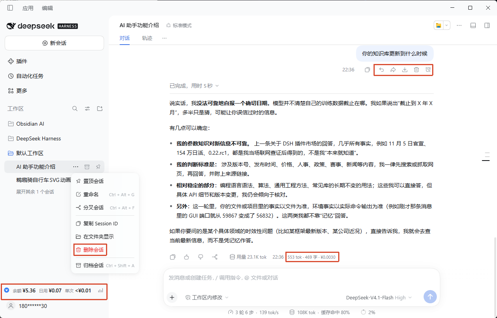
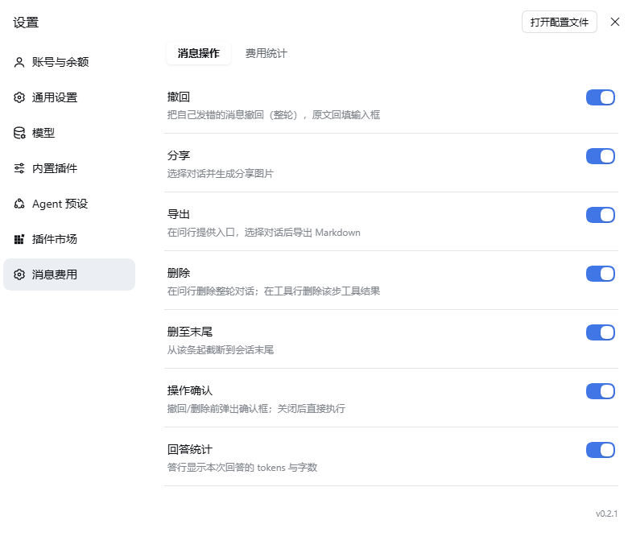
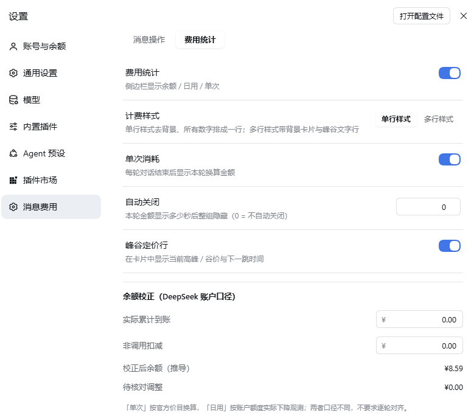

# DSH 插件 dsh-message-actions

[English](README.md) · 中文

## 简介

**让 DSH 的每一轮对话都可控、可分享、可计量。**

DSH 本身没有撤回和删除，发错一句只能重开会话；想把一段对话发给别人，也得自己复制排版。部分插件功能堆得重、数据去向不透明，于是干脆自己写一个：需要的功能都有，能不碰的数据就不碰。

- 发错消息：鼠标移到提问行点「撤回」，整轮问答消失，原文回到输入框，改完再发。
- 想清掉跑偏的探索：问行「删除」删整轮；只去掉某一步的工具调用，就点该工具行右侧的垃圾桶。
- 想分享给同事：多选轮次，导出 Markdown 或生成长图 PNG，都在本地完成、不上传。
- 想知道刚才那轮花了多少：侧边栏显示余额 / 日用 / 单次消耗（卡片上简写为「单次」）；本地模型自动收起为「本地模型 · 无需计费」。

用不上的功能可以在设置里关闭。比如关掉费用统计后，插件会停止余额取数与记账，也不再渲染侧边栏卡片；删除、分享、导出等开关同理，关掉后对应入口与动作都不再出现。它不常驻面板、不弹更新提示、不发系统通知，也不会改写你的提问；分享 / 导出会打开临时全屏选择浮层，撤回 / 删除会按设置弹出确认框，都是正常交互。

---

## 界面截图

**提问行操作按钮、回答下方的统计信息、侧边栏底部的费用卡片**



**设置 → 消息费用 → 消息操作**



**设置 → 消息费用 → 费用统计**



---

## 功能

| 功能 | 说明 |
|---|---|
| **撤回** | 点一下，整轮问答从会话里消失，原文自动回到输入框，改完再发 |
| **删除** | 问行删整轮问答；工具行删该步内容（同一步的答行 / 其它工具结果会一并遮蔽，其它步骤不受影响） |
| **删至末尾** | 从这一条起全部清掉，适合把一个话题彻底收尾 |
| **分享长图** | 全屏勾选想要的轮次，一键生成长图 PNG，本地生成、不上传 |
| **导出 Markdown** | 同样多选，按轮次导出带「问 / 答」结构的 `.md` |
| **回答统计** | 每条回答下方显示 `tok · 字`，一眼看清这次回复的体量 |
| **导航同步** | 删除后侧边栏对应刻度自动隐藏并收拢空隙，不留「幽灵条目」 |
| **费用卡片** | 余额 / 日用 / 单次消耗 一眼看完，有单行 / 多行两套计费样式 |
| **峰谷提示** | 高峰橙、谷价蓝，告诉你现在贵不贵、几点切换 |
| **余额校正** | 充值、赠金、异常扣减导致数字对不上时，一次性校正 |
| **中英双语** | 跟随 DSH 语言，界面与悬浮提示自动切换 |
| **浮层键盘** | 分享 / 导出浮层内 `Enter` 执行主操作（生成图片 / 导出）；确认框内 `Enter` 确认、`Esc` 取消；焦点在输入框内时不拦截，主操作禁用或生成中时不做任何事 |

删除采用的是**墓碑式表面替换**：只追加一条标记并遮蔽原区间，不改写历史日志，也不影响其他会话。标记持久化在会话事件日志里，因此刷新页面、切换到其它对话再切回、以及重启 DSH 后，被删内容都不会重新出现。`/messages` 与 `full=1` 都会按墓碑重算可见节点，而不是只相信宿主表面。

---

## 费用卡片

**单行样式**（默认，无背景、单行居左）：

```
▲ 余额 ¥6.00    日用 ¥0.08    单次 ¥0.02
```

**多行样式**（带背景卡片与峰谷文字行）：

```
余额 ¥6.00    日用 ¥0.08    单次 ¥0.02
▲ 谷价 · 明日 9:00 起高峰
```

新安装默认是**单行样式**；已经保存过偏好的用户沿用原来的选择，不会因为改默认值被重置。

- 高峰 = 暖橙，谷价 = 冷蓝；14px SVG 状态图标，左侧一眼可辨。
- 侧边栏收起时自动降级为一个钱币图标，悬停即可看到余额。
- 本地模型 / 非 DeepSeek 路由自动收起为「本地模型 · 无需计费」，不打扰。

| 项 | 含义 |
|---|---|
| 余额 | DeepSeek 账户当前余额（人民币），最短间隔 60 秒刷新一次；点击卡片可强制刷新，不受该间隔限制 |
| 日用 | 今天（北京时间）观测到的余额下降累计值 |
| 单次 | 最近一轮消耗的换算金额；默认常驻，可设 0–600 秒后自动隐藏 |

- 「单次消耗」按官方价目（`deepseek-flash` / `deepseek-v4-pro`）与实际用量估算；内部记账精度高于界面显示精度，避免很小的费用被舍成 0。
- 峰谷按北京时间：工作日 `09:00–12:00`、`14:00–18:00` 为高峰，其余为谷价；谷价为高峰的 `0.5` 倍。
- 「日用」来自账户余额的实际下降观测，与「单次消耗」口径不同，不要求逐轮对齐。
- 余额上升时不会冲减已记消费，而是标记「待核对」，引导到「余额校正」。

---

## 安装

### 插件市场

在 DSH 插件市场搜索 `dsh-message-actions` 安装；尚未上架时可改用下方的本地安装。安装后重启 DSH。

### 本地安装

```bash
git clone <repository-url> dsh-message-actions
cd dsh-message-actions
node build.mjs          # 生成 lib/
node test/check.mjs     # 应输出 ALL CHECKS PASSED
```

把构建后的目录装进 DSH profile：

```bash
pnpm add "file:/path/to/dsh-message-actions"
```

- `pnpm add file:` 是**复制**语义：改代码后需卸载重装（或加 `--force`）。
- 宿主侧改动（`src/index.mjs`、Config）需重启 DSH；纯客户端改动可「禁用 → 启用插件」或刷新页面。
- 登记：把包名加入 profile `package.json` 的 `dsh.profile.bundles`。
  **不要**在 profile 的 `cordis.patch.yml` 里再追加 `insert`——插件包自带的 patch 已在 bundle 层插入自身，重复 insert 会导致设置页「无法保存设置」。

---

## 使用

1. 鼠标悬停在任意**提问**上，右侧出现：撤回、分享、导出、删除、删至末尾。
2. 鼠标悬停在**工具调用行**上，右侧出现「删除该工具行」；删除的是该 `(turn, step)` 的节点集合——同一步的答行 / 其它工具结果会一并消失，其它步骤不受影响。
3. 每条**回答**下方显示 `tok · 字`。
4. 撤回与删除类操作默认弹出确认框；关闭「操作确认」后直接执行；确认后对应内容消失，侧边栏刻度同步隐藏。
5. 分享 / 导出打开全屏选择面板，每张卡片显示该轮的「问」与「答」预览，可单选、多选或全选；生成时再按需拉取完整原文。
6. 生成回复期间所有按钮置灰，避免与运行中的会话冲突。

### 余额校正

设置 → 消息费用 → 费用统计 → **余额校正**：

```
校正后余额 = 基线 − 已观测消费 + 实际累计到账 − 非调用扣减
```

两项均为**累计口径**（填「到目前为止的总数」，覆盖保存），允许校正后余额为负。

---

## 设置

设置 → 插件 → **消息费用**（English: `Messages & Cost`），页内两个标签，改动**即时保存并立即生效**。

**消息操作**

| 开关 | 作用 |
|---|---|
| 撤回 | 提问行显示「撤回」 |
| 分享 | 提问行显示「分享」 |
| 导出 | 提问行显示「导出」 |
| 删除 | 提问行删除整轮问答；工具行删除该步工具结果 |
| 删至末尾 | 提问行显示「删至末尾」 |
| 操作确认 | 撤回与删除类操作是否弹确认框 |
| 回答统计 | 回答下方是否显示 `tok · 字` |

**费用统计**

| 设置 | 作用 |
|---|---|
| 费用统计 | 侧边栏显示余额 / 日用 / 单次消耗；关闭后停止取数与记账 |
| 计费样式 | `单行样式`（默认，无背景）/ `多行样式`（带背景与峰谷行），即时切换并持久保存 |
| 单次消耗 | 每轮结束后显示本轮金额；关闭后不再渲染该组 |
| 自动关闭 | 本轮金额显示秒数（0–600，0 = 常驻） |
| 峰谷定价行 | 显示当前时段与下一次切换时间 |
| 余额校正 | 见上节 |

---

## 隐私与安全

这一节只写代码里实际做了的事情。它是降低风险的设计，不是「零风险」的承诺；下面每条都能在 `src/` 里找到对应实现。

**接口只对本机开放**

- 插件不自建端口，路由注册在 DSH 现有的 `webServer` 上。
- 每个请求都校验 `Host` 必须是 `localhost`、`127.0.0.0/8` 或 `::1`，否则返回 `403`；这挡住了 DNS rebinding 与局域网来源。
- 浏览器请求还要过 `Sec-Fetch-Site`：只接受 `same-origin` / `none`，或非浏览器客户端缺失该头；显式拒绝 `cross-site` 与 `same-site`。
- 携带 `Origin` 的请求必须与宿主当前同源；宿主给不出期望 `Origin` 时，带 `Origin` 的请求一律拒绝。

**响应头与写请求**

- 所有 JSON 响应统一带 `cache-control: no-store`、`x-content-type-options: nosniff`、`referrer-policy: no-referrer`、`cross-origin-resource-policy: same-origin`、`content-security-policy: default-src 'none'; frame-ancestors 'none'`。
- 写请求只接受 `content-type: application/json`；请求体上限 1MB，超限返回 `413` 并排空连接；方法不匹配返回 `405`（带 `allow` 头），错误体同样是统一 JSON。
- 不返回任何 CORS 放行头。

**会话数据**

- `GET /messages` 是**摘要接口**：只回消息 id、轮次、step、最多 200 字符的短预览、用量与工具 `callId`，不含正文。客户端不设固定轮询定时器：会话 DOM 变化时触发，经 120ms 合并调度，并用 3 秒 TTL 避免重复请求。
- `preview` 只对真实提问与助手回答生成；system / developer 消息、运行时注入的上下文与工具结果一律回空，正文不会被该接口回传（代码位置：`src/shared.cjs` 的 `messagesSummaryOf`）。
- 分享图与导出需要全文时，才按选中的轮次请求 `full=1`，且只返回问 / 答文本。

**费用数据**

- 只存一个本地文件：`$DSH_HOME`（默认 `~/.dsh`）下的 `plugins/dsh-message-actions/cost-state.json`。
- 写入方式是「同目录临时文件（`0600`）→ `fsync` → `rename`」整份替换，避免写一半留下坏文件；目录按 `0700` 创建。
- 内容只有余额观测、校正值与按日消费，没有对话正文。
- 文件超过 4MB 会自动重建为默认状态，并记一条含原因与大小的诊断日志；未超限但 JSON 损坏时，原文件改名为 `cost-state.bad-<时间戳>.json` 留档。

**网络**

- 插件自身不直接向外部地址发起请求；客户端只请求同源的 `/dsh-message-actions/*`。
- 余额通过宿主已登录的 DeepSeek 账户服务（`deepseekAccount`）读取，这一步的网络请求由宿主发起；未登录时显示「未登录」。
- 插件不保存任何密钥；判断是否走 API key 时只向宿主凭据服务查询「是否存在」，不落盘、不回传。

---

## 已知限制

- 删除粒度：问行删整轮；工具行删该 step，会连带遮蔽同一步的答行与其它工具结果，其它步骤不受影响。
- 不支持撤销删除，也不会清理跨会话记忆。
- 删除标记保存在会话事件日志里：刷新、切换对话、重启 DSH 都不会恢复；如果手动删除整个会话目录，标记会随会话一起消失。
- 若宿主重建会话表面时没有重放墓碑，插件会根据 `goneTools` 重新隐藏工具行；这些行仍留在 DOM 中（CSS `display:none`），超大会话可能保留少量不可见节点。
- 侧边栏刻度由官方虚拟列表绘制，删过内容后滚过该区域可能出现空白。
- 入口依赖宿主的会话 DOM 结构：DSH 大版本升级后按钮可能不再出现（结果是静默消失，不会误删）。
- 「单次消耗」只含大模型调用费用，不含搜索 / 插件等外部计费。
- Web 模式未实测：同机 `localhost` 可能可用，局域网 / 远程访问会被安全围栏拒绝。

---

## 开发

```bash
node build.mjs        # 构建到 lib/
node test/check.mjs   # 离线断言，当前 2541 项
# 另有真实会话日志回归：18/18
```

```
src/
├── index.mjs    # 宿主：Config + 4 条 HTTP 路由 + 费用服务
├── client.js    # 客户端：槽位、DOM 注入、分享 / 导出浮层、费用卡片
├── shared.cjs   # 宿主与客户端共用的纯函数（可离线测试）
├── store.cjs    # 费用状态文件原子读写、损坏恢复
├── http.cjs     # HTTP 工具：JSON 响应、413 排空、请求体读取
└── i18n.cjs     # 中英文案单一来源（构建时生成 locale/*.json）
test/check.mjs   # 无依赖的断言脚本
```


- 版本：`0.2.1`
- 兼容：在 DSH `0.2.1-rc.5` 桌面版（profile `desktop`）实测通过
- 依赖：无运行时第三方依赖

---

## License

[MIT](LICENSE)
