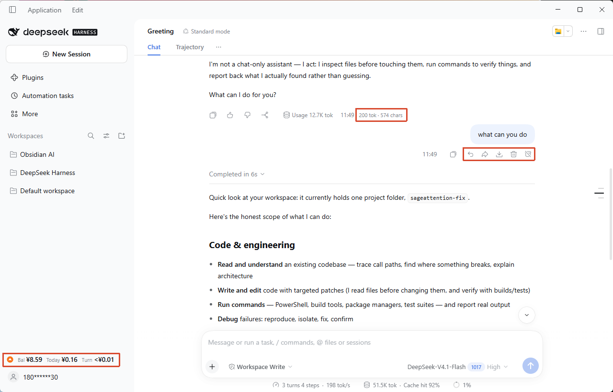
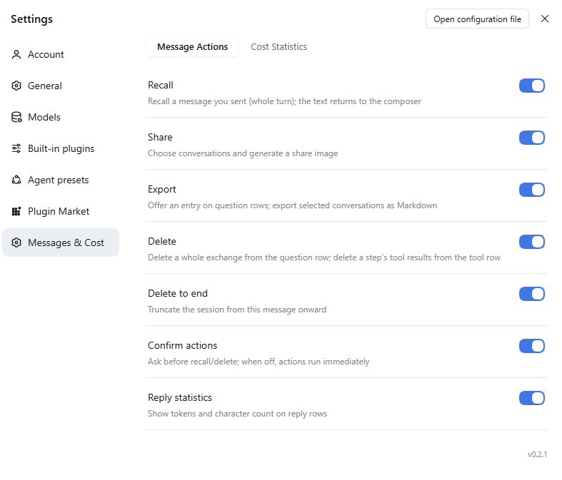
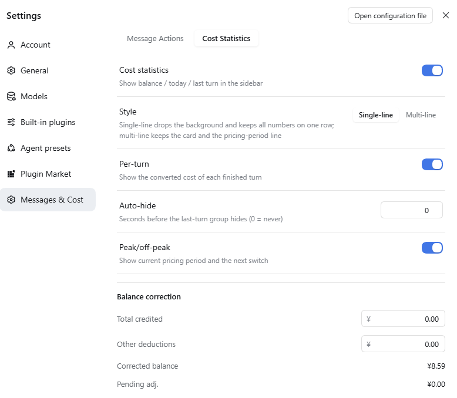

# DSH plugin dsh-message-actions

English · [中文](README.cn.md)

## Overview

**Make every turn in DSH controllable, shareable, and measurable.**

DSH has no recall or delete built in: send a message by mistake and your only option is to start a new session; share a conversation and you end up copying, pasting, and re-formatting by hand. Some plugins are overloaded with features or vague about where conversation data ends up, so I wrote my own: the features I needed, and data I don't need to touch stays untouched.

- Sent the wrong message: hover over a question row, click "Recall", the whole turn disappears and the text returns to the composer; edit and resend.
- Cleaning up a tangent: "Delete" on the question row removes the whole turn; to drop just one step's tool call, click the trash icon on that tool row.
- Sharing with a colleague: select the turns you want, export Markdown or generate a long PNG, all locally, nothing uploaded.
- Wondering what the last turn cost: the sidebar shows balance / today / per-turn cost (shown as "Bal / Today / Turn" on the card); local models collapse to "Local · no billing".

Features you don't use can be turned off in settings. Turn off cost statistics, for example, and the plugin stops fetching balances and recording spend, and stops rendering the sidebar card. The delete, share, and export switches work the same way: turn them off and their entries and actions disappear. It adds no persistent panel, no update prompts, and no system notifications, and it never rewrites your question. Share and export open a temporary full-screen picker, and recall / delete show a confirmation dialog according to your settings — all normal interactions.

---

## Screenshots

**Actions on the question row, reply statistics under answers, and the cost card at the bottom of the sidebar**



**Settings → Messages & Cost → Message Actions**



**Settings → Messages & Cost → Cost Statistics**



---

## Features

| Feature | What it does |
|---|---|
| **Recall** | One click removes the whole exchange from the session and restores the original text to the composer, ready to resend |
| **Delete** | Question row deletes the whole exchange; tool row deletes that step (the answer and other tool results in the same step are hidden too, other steps are unaffected) |
| **Delete to end** | Removes everything from this message to the end, for closing off a topic |
| **Share as image** | Pick the turns you want in a full-screen overlay and generate a long PNG, generated locally, never uploaded |
| **Export Markdown** | Same selection, exports a `.md` with question / answer structure per turn |
| **Reply statistics** | `tok · chars` under every answer, the size of a reply at a glance |
| **Rail sync** | After deletion, the matching sidebar ticks hide and the gaps close, leaving no ghost entries |
| **Cost card** | Balance / today / per-turn cost at a glance, with single-line and multi-line billing styles |
| **Peak / off-peak hint** | Peak in orange, off-peak in blue, showing whether now is expensive and when it switches |
| **Balance correction** | One-off correction when top-ups, credits, or unexpected deductions make the numbers disagree |
| **Bilingual UI** | Follows the DSH language; interface and tooltips switch automatically |
| **Overlay keyboard** | In the share / export overlay, `Enter` runs the primary action (Share image / Export); in a confirmation dialog it confirms, and `Esc` cancels. Enter is ignored while focus is in a text field, and when the primary action is disabled or busy |

Deletion uses **tombstone-style surface replacement**: it only appends a marker and hides the original span; it never rewrites the history log and doesn't affect other sessions. The marker is persisted in the session event log, so deleted content stays hidden after a page refresh, after switching to another conversation and back, and after restarting DSH. `/messages` and `full=1` both recompute the visible set from those markers instead of trusting the host surface alone.

---

## Cost card

**Single-line** (default, no background, one row aligned left):

```
▲ Bal ¥6.00    Today ¥0.08    Turn ¥0.02
```

**Multi-line** (with a background card and a peak / off-peak text row):

```
Bal ¥6.00    Today ¥0.08    Turn ¥0.02
▲ Off-peak · peak at 9:00 tomorrow
```

New installations default to **single-line**; users who have already saved a preference keep their choice and are not reset by the new default.

- Peak = warm orange, off-peak = cool blue; 14px SVG status icons, readable at a glance on the left.
- When the sidebar collapses, the card degrades to a coin icon; hover to see the balance.
- Local models / non-DeepSeek routing collapse to "Local · no billing", out of the way.

| Item | Meaning |
|---|---|
| Bal | Current DeepSeek account balance (CNY), refreshed at a minimum interval of 60 seconds; clicking the card forces a refresh regardless of that interval |
| Today | Cumulative balance drop observed today (Beijing time) |
| Turn | Converted cost of the most recent turn; shown by default, can hide after 0–600 seconds |

- "Turn" (per-turn cost) is estimated from official list prices (`deepseek-flash` / `deepseek-v4-pro`) and actual usage; internal accounting is more precise than the UI, so very small costs are not rounded down to zero.
- Peak / off-peak uses Beijing time: weekdays `09:00–12:00` and `14:00–18:00` are peak, everything else is off-peak; off-peak is `0.5×` the peak price.
- "Today" comes from observing actual balance drops; it uses a different basis from "per-turn cost" and is not expected to match turn by turn.
- When the balance goes up, recorded spend is not reduced; the card shows "Check" and points you to balance correction.

---

## Installation

### Plugin marketplace

Search for `dsh-message-actions` in the DSH plugin marketplace and install it (if it isn't listed yet, use the local install below), then restart DSH.

### Local install

```bash
git clone <repository-url> dsh-message-actions
cd dsh-message-actions
node build.mjs          # writes lib/
node test/check.mjs     # should print ALL CHECKS PASSED
```

Install the built directory into a DSH profile:

```bash
pnpm add "file:/path/to/dsh-message-actions"
```

- `pnpm add file:` uses **copy** semantics: after editing code, reinstall (or pass `--force`).
- Host-side changes (`src/index.mjs`, Config) need a DSH restart; client-only changes can be picked up by disabling → enabling the plugin, or refreshing the page.
- Registration: add the package name to `dsh.profile.bundles` in the profile `package.json`.
  **Do not** append another `insert` in the profile's `cordis.patch.yml` — the package's own patch already inserts itself at the bundle layer, and a duplicate insert makes the settings page fail to save.

---

## Usage

1. Hover over any **question** row: Recall, Share, Export, Delete, Delete to end appear on the right.
2. Hover over a **tool-call row**: "Delete tool" appears on the right; it deletes the node set for that `(turn, step)` — the answer and other tool results in the same step disappear too; other steps are unaffected.
3. Under every **answer**, `tok · chars` is shown.
4. Recall and delete actions ask for confirmation by default; turn off "Confirm actions" to run them immediately. After confirming, the content disappears and the sidebar ticks hide in sync.
5. Share / export opens a full-screen picker; each card shows the question and answer preview for that turn, and you can select one, several, or all; full text is fetched only when you generate.
6. While a reply is being generated, all buttons are disabled to avoid conflicting with the running session.

### Balance correction

Settings → Messages & Cost → Cost Statistics → **Balance correction**:

```
Corrected balance = baseline − observed spend + total credited − non-usage deductions
```

Both inputs are **cumulative** ("total so far", saved as an overwrite); the corrected balance may be negative.

---

## Settings

Settings → Plugins → **Messages & Cost**; the page has two tabs, and changes **save immediately and apply right away**.

**Message Actions**

| Toggle | Effect |
|---|---|
| Recall | Show "Recall" on question rows |
| Share | Show "Share" on question rows |
| Export | Show "Export" on question rows |
| Delete | Question row deletes the whole exchange; tool row deletes that step's tool results |
| Delete to end | Show "Delete to end" on question rows |
| Confirm actions | Whether recall and delete actions ask for confirmation |
| Reply statistics | Whether `tok · chars` is shown under answers |

**Cost Statistics**

| Setting | Effect |
|---|---|
| Cost statistics | Show balance / today / per-turn cost in the sidebar; when off, stop fetching and recording |
| Style | `Single-line` (default, no background) / `Multi-line` (card with the peak / off-peak row), switch instantly and persist |
| Per-turn | Show the cost of each finished turn; when off, don't render that group |
| Auto-hide | Seconds before the turn cost hides (0–600, 0 = always) |
| Peak/off-peak | Show the current pricing period and the next switch |
| Balance correction | See the previous section |

---

## Privacy and security

This section only describes what the code actually does. It is risk reduction, not a "zero-risk" promise; every claim below maps to an implementation under `src/`.

**The interface is reachable from this machine only**

- The plugin doesn't open its own port; routes register on DSH's existing `webServer`.
- Every request checks that `Host` is `localhost`, `127.0.0.0/8`, or `::1`, otherwise it returns `403`; this blocks DNS rebinding and LAN origins.
- Browser requests also go through `Sec-Fetch-Site`: only `same-origin` / `none`, or a non-browser client that omits the header, is accepted; `cross-site` and `same-site` are rejected explicitly.
- Requests carrying `Origin` must be same-origin with the host; when the host can't provide an expected `Origin`, any request with `Origin` is rejected.

**Response headers and write requests**

- Every JSON response carries `cache-control: no-store`, `x-content-type-options: nosniff`, `referrer-policy: no-referrer`, `cross-origin-resource-policy: same-origin`, and `content-security-policy: default-src 'none'; frame-ancestors 'none'`.
- Write requests only accept `content-type: application/json`; the body limit is 1MB, and oversized bodies get `413` with the connection drained; a wrong method gets `405` (with an `allow` header), and the error body is the same JSON shape.
- No CORS allow headers are returned.

**Conversation data**

- `GET /messages` is a **summary** interface: it returns message ids, turn, step, a preview of at most 200 characters, usage, and the tool `callId`; no body text. The client has no fixed polling timer: it refetches when the conversation DOM changes, coalesced by a 120 ms scheduler, with a 3-second TTL to avoid duplicate requests.
- `preview` is only generated for real questions and assistant answers; system / developer messages, runtime-injected context, and tool results are always empty, so their text is never returned by this endpoint (implementation: `messagesSummaryOf` in `src/shared.cjs`).
- Share images and export fetch full text only for the selected turns via `full=1`, and only questions / answers are returned.

**Cost data**

- Only one local file: `cost-state.json` under `$DSH_HOME` (default `~/.dsh`), in `plugins/dsh-message-actions/`.
- Writes are a whole-file replacement: temp file in the same directory (`0600`) → `fsync` → `rename`, so a half-written file can't be left behind; the directory is created with `0700`.
- Contents are only balance observations, correction values, and per-day spend; no conversation text.
- A file over 4MB is rebuilt as the default state and logged with the reason and size; a corrupt file under the limit is renamed to `cost-state.bad-<timestamp>.json` and kept.

**Network**

- The plugin itself does not make requests to external addresses; the client only calls same-origin `/dsh-message-actions/*`.
- The balance is read through the host's signed-in DeepSeek account service (`deepseekAccount`); that network request is made by the host. When signed out, it shows "Signed out".
- The plugin stores no keys; to decide whether an API-key path applies, it only asks the host credential service whether one exists, without persisting it or returning it.

---

## Known limitations

- Deletion granularity: the question row deletes the whole turn; the tool row deletes that step, hiding the answer and other tool results in the same step. Other steps are unaffected.
- No undo for deletion, and no cross-session memory cleanup.
- Deletion markers live in the session event log. They survive refresh, conversation switching, and a DSH restart; deleting the session directory removes the markers along with the session.
- If the host ever rebuilt the conversation surface without replaying the tombstone, this plugin hides the removed tool rows again from `goneTools`; the hidden rows still exist in the DOM (CSS `display:none`), so very large sessions may keep some invisible nodes.
- The sidebar ticks are drawn by the official virtual list; after deleting content, scrolling past that area may show blank space.
- Entries depend on the host's conversation DOM structure: after a major DSH upgrade the buttons may stop appearing (they disappear silently rather than deleting the wrong thing).
- "Per-turn cost" covers model calls only, not external billing such as search or plugins.
- Web mode is untested: `localhost` on the same machine may work; LAN / remote access is rejected by the security fence.

---

## Development

```bash
node build.mjs        # build to lib/
node test/check.mjs   # offline assertions, 2541 currently
# plus a real session-log regression: 18/18
```

```
src/
├── index.mjs    # host: Config + 4 HTTP routes + cost service
├── client.js    # client: slots, DOM injection, share / export overlay, cost card
├── shared.cjs   # pure functions shared by host and client (offline testable)
├── store.cjs    # cost state file: atomic read/write, recovery on corrupt files
├── http.cjs     # HTTP helpers: JSON responses, 413 drain, body reading
└── i18n.cjs     # single source for Chinese/English copy (builds locale/*.json)
test/check.mjs   # dependency-free assertion script
```


- Version: `0.2.1`
- Compatible with: tested on DSH `0.2.1-rc.5` desktop (profile `desktop`)
- Dependencies: none at runtime

---

## License

[MIT](LICENSE)
